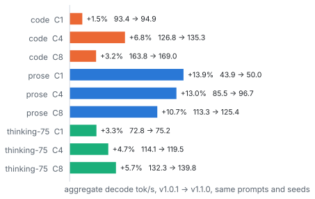

<h1 align="center">DeepSeek-V4.1-Flash-1017 on two DGX Sparks</h1>

<p align="center">A sparkrun recipe for DeepSeek-V4.1-Flash-1017 (EXL3 2.9 bpw, Engram from local NVMe) at TP=2 over CX-7.<br>TensorFold-based engine, exact DSpark drafts with a refit drafter, OpenAI-compatible endpoint.</p>

<table align="center">
  <tr>
    <td align="center"><h2>93 tok/s</h2><b>decode C1</b><br><sub>code, T=1.0, top_p 1.0; v1.0.1: 89</sub></td>
    <td align="center"><h2>169 tok/s</h2><b>decode aggregate C8</b><br><sub>code, T=1.0, top_p 1.0</sub></td>
    <td align="center"><h2>49 tok/s</h2><b>decode C1, prose</b><br><sub>+12% over v1.0.1, same prompts</sub></td>
    <td align="center"><h2>1,701 tok/s</h2><b>prefill C1, 32K</b><br><sub>real text, TTFT 19.3 s</sub></td>
  </tr>
</table>

<p align="center"><sub>262K context, 8 sequences in parallel, FP8 KV, DSpark drafts with drafter D1, two boots on my pair, v1.1.0 release settings, 2026-10-25</sub></p>

<details>
<summary><sub>Measurement details</sub></summary>

| Metric | Value per boot | Workload | Sampling | Date | Statistic |
|---|--:|---|---|---|---|
| Decode C1, code | 92.8 tok/s | 3 of 8 short code prompts, one per run, 512 tokens, thinking off | T=1.0, top_p 1.0 | 2026-10-25 | median of 3 runs, as v1.0.1 (88.7) |
| Decode aggregate C8, code | 168.7 tok/s | all 8 code prompts at once | T=1.0, top_p 1.0 | 2026-10-25 | median of 3 runs, as v1.0.1 (163.8) |
| Decode C1, prose | 49.4 tok/s | 3 of 8 short prose prompts, one per run, 512 tokens | T=1.0, top_p 1.0 | 2026-10-25 | median of 3 runs, as v1.0.1 (44.2) |
| Prefill C1, 32K | 1,713 / 1,690 tok/s | one 32,792-token prompt of real text (docs, changelogs, license texts), fresh nonce, `max_tokens` 1 | n/a | 2026-10-25 | median of 3 prompts, two boots |
| TTFT, 32K prompt | 19.2 / 19.4 s | same | n/a | 2026-10-25 | median of 3 prompts, two boots |

The tiles show the median over both boots. Image `ghcr.io/ursuciprian/ds41-tensorfold:v1.1.0` (engine commit
`bb619cf`) with drafter D1 and the settings in [recipes/](recipes/).

The v1.0.1 headline (89 tok/s at C1) was a median of three runs. At C1 each run is one prompt, and the third code
prompt runs at about 77 tok/s, so a median of three and a median of two are not comparable there. On the same two
prompts and seeds, v1.0.1 gave 92.7 / 93.6 tok/s on code and 43.8 / 43.9 on prose. Every v1.0.1 comparison below
uses those same prompts and seeds.

Method, prompts and the full matrix: [BENCHMARKS.md](BENCHMARKS.md). Chart data: [docs/data/bench.csv](docs/data/bench.csv).

</details>

This is a work in progress. I am working on speed (prefill at 4K, scheduling under concurrency, the drafter on
code), and the numbers above are what the recipe in this repo does today. Nothing here counts a speedup I have not
measured end to end.

## Quick start

Requirements:

- 2x DGX Spark with the ConnectX-7 ports cabled back to back, both RoCE rails up.
- [sparkrun](https://sparkrun.dev) 0.3.8 or newer, with both nodes reachable over SSH.
- About 315 GiB free on each node's NVMe, and about 285 GiB more on the node that packs the Engram tables
  while it packs (see [Hardware and storage](#hardware-and-storage)).
- The checkpoint, the drafter overlay and the packed Engram shards in place under `/srv/ds41` on both nodes:
  [docs/setup.md](docs/setup.md) walks through the download, the packing, the copy to the worker and the drafter.

```sh
sparkrun registry add https://github.com/ursuciprian/DeepSeek-V4.1-Flash-1017-2x-DGX-Spark
sparkrun run deepseek-v4.1-flash-1017-2x-dgx-spark --hosts <head>,<worker> \
  -e DS41_MASTER=<head CX-7 IPv4> --no-follow
```

Upgrading from v1.0.1: build `/srv/ds41/checkpoint-d1` on both nodes first
([docs/setup.md](docs/setup.md#drafter-d1)), or set `model:` back to `/srv/ds41/checkpoint` in your copy of the recipe.

`DS41_MASTER` is the head's address on the CX-7 link. Without it the ranks meet on the head's default-route
address, which on a Spark is often Wi-Fi. sparkrun pulls the image
`ghcr.io/ursuciprian/ds41-tensorfold:v1.1.0` (about 11 GB to download, 25 GB unpacked) on the first
run.

`sparkrun run` returns before the engine is ready. A boot takes about 5 minutes (295-300 s on four boots on my
pair; the first boot of a new image also compiles kernels and measures a cost table). Wait for health, then
send a request:

```sh
H=http://<head>:8888
until [ "$(curl -s -o /dev/null -w '%{http_code}' $H/health)" = 200 ]; do sleep 10; done
curl -s $H/v1/chat/completions -H 'Content-Type: application/json' -d '{
  "model": "deepseek-v4.1-flash-1017", "max_tokens": 2048,
  "messages": [{"role": "user", "content": "Write a Python function that reverses a string."}]}'
```

Thinking is on by default at effort `high` (75 on the engine's 1-100 scale, the thinking-75 rows in the
benchmarks). Turn it off per request with `"chat_template_kwargs": {"thinking": false}`, or set
`"reasoning_effort"` to `low`, `medium`, `high`, `max` or a number from 1 to 100.
`max_tokens` covers the reasoning and the answer together.

The server binds 0.0.0.0 with no API key. Keep it on a trusted network or put an authenticating proxy in front.
Stop it with `sparkrun stop --all`.

<details>
<summary>Paths, interfaces and other settings in the recipe</summary>

- Host paths. sparkrun fills `{model}` in the serve command from the recipe's `model:` field and mounts that
  folder at the same path. It does not fill placeholders in `executor_config.volumes`, so the recipe uses fixed
  paths: `/srv/ds41/checkpoint-d1`, `/srv/ds41/engram-shards`, `/srv/ds41/tf-state` and the seccomp profile
  `/srv/ds41/seccomp-io-uring.json`. Put the files there, make `/srv/ds41` a symlink to where they are, or edit
  those lines in your copy of the recipe.
- Drafter. `model:` is the checkpoint folder with drafter D1 laid over it ([docs/setup.md](docs/setup.md#drafter-d1)).
  Set it to `/srv/ds41/checkpoint` to serve the checkpoint's own drafter: the replies are the same, and on my pair
  prose decodes 6% to 12% slower.
- Interfaces. `NCCL_SOCKET_IFNAME=enp1s0f1np1` and `NCCL_IB_HCA=rocep1s0f1,roceP2p1s0f1` are the names a DGX
  Spark uses by default. If `ip -br link` and `ibv_devices` show other names on your nodes, change them, or delete
  the two lines and let sparkrun detect them. The RoCE v2 GID index is read from sysfs on each rank at start,
  because it can change between boots.
- Sampler. Requests that send no sampler get T 1.0, top_p 0.95, top_k 0. Change these server defaults with
  `-o temperature=...`, `-o top_p=...` and `-o top_k=...`. DeepSeek's card sampler (T 1.0, top_p 1.0) works with
  the GPU sampler the recipe turns on (`TF_DSV41_GPU_SAMPLE=1`); the benchmark rows below use it.
- Context 262,144 tokens, 8 sequences in parallel (aggregate decode still rises from C4 to C8 on my pair), FP8 KV
  cache, a shared KV pool of 1,048,576 tokens: 4 sessions at full context, or 8 whose prompt plus `max_tokens`
  stays under about 131,000 tokens each ([#8](../../issues/8)).
- seccomp. The Engram gate runs in a C worker that reads rows with io_uring (`TF_DSV41_ENGRAM_CGATE=1`). Docker's
  default seccomp profile refuses io_uring, so the recipe points the container at
  [recipes/seccomp-io-uring.json](recipes/seccomp-io-uring.json): Docker's default profile plus `io_uring_setup`,
  `io_uring_enter` and `io_uring_register`, nothing else. Copy it to `/srv/ds41/seccomp-io-uring.json` on both
  nodes. Without the `security_opt` line the worker is meant to fall back to a pool of pread threads; I have not
  booted that configuration.
- Depth policy. `TF_DSV41_ROUND_MS` is a table of round times measured on my pair with the v1.0.0 image. A table
  measured again on the v1.1.0 image was no faster, so the recipe keeps it. If your pair differs, the line can be
  removed and the engine prices rounds from the cost table it calibrates at boot. I have not measured that
  combination.
- Metrics. `GET /metrics` on port 8888 returns Prometheus text: requests, errors, prompt, completion and cached
  tokens, decode rounds, drafted and accepted draft tokens, decode and prefill seconds.

</details>

## v1.1.0 against v1.0.1

<picture><source media="(prefers-color-scheme: dark)" srcset="docs/img/compare-dark.svg"></picture>

<sub>Aggregate decode tok/s, DeepSeek's card sampler (T=1.0, top_p 1.0), 512 tokens (reasoning included for
thinking-75), the same prompts and seeds on both. v1.0.1: two boots on 2026-10-22, the first two of its three runs
per cell. v1.1.0: two boots on 2026-10-25, two runs per cell. Median per cell over the four runs. The two versions
ran on different days, not alternated.</sub>

What changed:

- Drafter D1. I refit the checkpoint's DSpark drafter on the model's own replies and merged the result into the
  drafter's 6-bit layers at half strength. The main model is unchanged and every draft is still verified, so the
  replies are token-identical to the checkpoint's own drafter (the exactness lane below). In an alternating A/B
  on the v1.1.0 image (four boots), D1 gave prose +6.6% to +11.6% in every cell, thinking-75 +1.9% to +3.6%, and
  code +1.1% and +1.3% at C1 and C4; the other cells were within noise ([#6](../../issues/6)).
- Engine (commit `bb619cf`). Prefill without host syncs in the MoE and with parallel streams for the shared expert
  and the attention projections, a first round that verifies alone, less work outside verify in each round, the
  drafter's input taken in one batch per round, and draft graphs for up to 8 requests. Time to first token on a
  short prompt: 0.338 to 0.316 s on `/v1/chat/completions`, 0.225 to 0.201 s on `/v1/completions`.
- Prefill on real text: 1,122 / 1,701 / 1,842 tok/s at 4K / 32K / 128K, against 1,131 / 1,665 / 1,831 on v1.0.1.
  4K stays where it was ([#9](../../issues/9)).

Two cells need a caveat. Code at C4 varied from 127 to 136 tok/s across the four v1.0.1 boots of the graph-rows
A/B in [BENCHMARKS.md](BENCHMARKS.md), so part of its +6.8% can be boot noise. Thinking-75 at greedy C1 came out
0.8% to 1.2% lower with D1 in each of the three A/Bs I ran, against a 1% noise floor: I count that as a possible
small loss.

## Performance

<picture><source media="(prefers-color-scheme: dark)" srcset="docs/img/decode-dark.svg"></picture>
<picture><source media="(prefers-color-scheme: dark)" srcset="docs/img/prefill-dark.svg"></picture>

<sub>Left: aggregate decode tok/s by concurrency, v1.1.0 recipe on 2026-10-25, T=1.0 top_p 1.0, 8 short prompts
per workload, 512 tokens (reasoning included for thinking-75), median of 2 runs on each of two boots. C2 was not
measured on this release. Right: prefill tok/s by prompt length, one request (C1) or four at once (C4, aggregate),
fresh nonce per prompt so nothing comes from a prefix cache. The exact and fast kernel lines use one paragraph
repeated (2026-10-18 and 2026-10-21, median of 3); the grey line is real text on v1.1.0 (median of 6 prompts over
two boots).</sub>

Decode goes from 94.9 tok/s at C1 to 169 tok/s at C8 on code. Prose drafts accept fewer tokens per round, so it
stays lower at every concurrency; D1 narrows that gap. On real text, prefill runs 1,122 tok/s at 4K, 1,701 at 32K
and 1,842 at 128K, against about 2,400 on the repeated paragraph. The 4K cell is noisy: per boot, the median of
three prompts was 1,214 on one boot and 1,114 on the other. MemAvailable stayed at or above 6.0 GiB on both ranks
from boot to the end of the gate.

## Quality gate

The full release gate passed on the v1.1.0 image with drafter D1 on 2026-10-25, at DeepSeek's card sampler
(T=1.0, top_p 1.0).

| Check | Result |
|---|---|
| Reasoning on and off, tool turn, tool-result-only turn, forced tool call | pass (forced call 3 of 3) |
| Hardmode agentic tool-use suite, T=1.0 | 91 (bar 88) |
| Identifier fidelity, six depths, prompts of 15,940 to 247,292 tokens | 20 of 20 exact at every depth in this run |
| Shared prefix, 4 concurrent chats | 16 of 16 exact |
| Long session | 29,026 tokens over 9 turns, no loop |
| Long decode, 32,768-token cap | no loop |
| Corruption | 0 corrupted characters |
| Exactness against the 2026-10-19 recipe, 32 sequences at C1 and at C8 | token-identical, 32 of 32 each |
| Greedy C1 replies against the v1.0.1 image, 27 replies | text-identical, 27 of 27 |
| Fast prefill vs exact kernels, logits over 16,376 teacher-forced positions (2026-10-19) | top-1 agreement 0.9982 (bar 0.995), mean KL 7.8e-4 (bar 1e-3) |

At 241K to 247K tokens the fidelity probe has an intermittent miss, and it is a memory limit, not a wrong answer.
In 2 of the 17 runs at that depth since 2026-10-24, 3 or 4 of the 20 items got no answer. In both, the server
refused exactly that many requests (HTTP 503): a cold 247K prefill needs about 0.55 GiB above a 4 GiB floor, and
rank 0 was about 40 MiB short after heavier probes earlier on the same boot. No item came back wrong. Ten more runs
on a fresh v1.1.0 boot with D1 were 20 of 20 every time, byte-identical across runs. I am tracking it in
[#11](../../issues/11). Details per lane: [BENCHMARKS.md](BENCHMARKS.md#gate). The gate is in [gate/](gate/) and
talks to the server over the OpenAI API only.

## History

<picture><source media="(prefers-color-scheme: dark)" srcset="docs/img/history-dark.svg"></picture>

<sub>2026-10-18: baseline with exact prefill kernels, decode at T=1.0 top_p 0.95. 2026-10-19: fast prefill kernels
(tuned grouped GEMM, 2048-row chunks) and the GPU sampler, decode at T=1.0 top_p 1.0. 2026-10-21, v1.0.0: ratio
depth policy with a measured round table, cheaper verify rows, decode at T=1.0 top_p 1.0. Median of 3 each, on a
repeated-paragraph prompt for prefill. v1.1.0 is not in this chart: its C1 cells use two prompts instead of three
and its prefill uses real text, so the bars would not compare. The section above compares it with v1.0.1.</sub>

## Hardware and storage

- 2x DGX Spark: GB10, 128 GB unified memory each. The engine allocates about 100.6 GiB per rank.
- ConnectX-7 back to back, both RoCE functions in use (`rocep1s0f1`, `roceP2p1s0f1`).
- Kernel `6.17.0-1032-nvidia` on both nodes. In earlier work on this pair, `7.0.0-1019-nvidia` broke NCCL memory
  registration once about 85 GB per node was GPU-resident.
- Local NVMe on each node, because the engine reads Engram rows from disk with O_DIRECT during decode:

| What | Size | Where |
|---|--:|---|
| EXL3 2.9 bpw checkpoint | 197 GiB | both nodes |
| Drafter D1 overlay and index (the rest of `checkpoint-d1` is hard links) | 0.5 GiB | both nodes |
| Packed Engram shards (2 files per rank) | 94.4 GiB | both nodes, each its own rank's files |
| Engram source shards 47 and 48 | 190 GiB | the node that packs; delete after packing |
| Rank 1's packed shards, staged for the copy | 94.4 GiB | the node that packs; delete after the copy |
| Engine image | 23 GiB | both nodes |

- Free memory is tight on unified memory. Run the nodes headless and keep at least 5 GiB MemAvailable;
  [docs/setup.md](docs/setup.md#memory) has the details.

## Status

- Recipe: the v1.1.0 settings (the v1.0.1 settings plus `TF_DSV41_FIRST_SERIAL`, `TF_DSV41_PF_MOE_LEAN`,
  `TF_DSV41_PF_SHARED_SIDE`, `TF_DSV41_PF_ATTN_STREAMS`, `TF_DSV41_INGEST_BATCH`, `TF_DSV41_DRAFT_GRAPH_SLOTS` and
  drafter D1) are in [recipes/](recipes/). I booted them with sparkrun on my pair, under the narrow seccomp
  profile. The file here differs from the booted one in host paths, container mount points, the request log name,
  how the rendezvous address is passed, an extra `SYS_PTRACE` capability for debugging on my boots, the server
  default top_p (1.0 on my boots, 0.95 here), and in how the new knobs went in: as `-e` flags at boot on my pair,
  as recipe lines here. I checked the running container's environment against this file: the engine settings
  match.
- Gate: the full release gate passed on the v1.1.0 image with drafter D1 on 2026-10-25, with exactness 32 of 32
  at C1 and at C8 and the lowest MemAvailable at 6.0 GiB.
- Image: `ghcr.io/ursuciprian/ds41-tensorfold:v1.1.0`, digest `sha256:8fc45823278530ae1e86ba35abec5746300af1b007bb07c898df6b270236211b`.
- In this release: drafter D1 [#6](../../issues/6). Not in it: the drafter head trim [#4](../../issues/4), screened
  again on the v1.1.0 image (thinking-75 C4 1.1% lower).
- In progress, tracked as issues; each change has to pass the gate before it lands in the recipe:
  - [#9](../../issues/9) prefill at 4K, [#4](../../issues/4) round overhead outside verify
  - [#11](../../issues/11) admission refusals at 241K to 247K tokens after heavy load on the same boot
  - a drafter refit with more code, GenAI and agentic prompts

## Repository

| Path | What |
|---|---|
| [recipes/](recipes/) | the sparkrun recipe |
| [docs/setup.md](docs/setup.md) | download, Engram packing, copy to the worker, drafter D1, headless setup, memory notes |
| [tools/pack_engram.py](tools/pack_engram.py) | packs the Engram tables into per-rank shards, and checks them |
| [gate/](gate/) | quality gate, speed matrix and exactness checks (OpenAI API only) |
| [BENCHMARKS.md](BENCHMARKS.md) | every number, with method and provenance |
| [scripts/make_charts.py](scripts/make_charts.py) | renders the charts from [docs/data/bench.csv](docs/data/bench.csv) |

## Acknowledgments

- The engine is my fork of [TensorFold](https://github.com/ashhart/TensorFold) with Jay Leaton's
  DeepSeek-V4.1-Flash family from
  [jayleaton/deepseek-v41-tensorfold-spark](https://github.com/jayleaton/deepseek-v41-tensorfold-spark).
  [tools/pack_engram.py](tools/pack_engram.py) is adapted from his Engram packer, and the image ships his prefill
  tile table unchanged.
- [recipes/seccomp-io-uring.json](recipes/seccomp-io-uring.json) is Docker's default seccomp profile from
  [moby/profiles](https://github.com/moby/profiles) with one rule added.
- The charts use the [Inter](https://github.com/rsms/inter) typeface (SIL OFL 1.1).

## License

Apache-2.0 for this repository ([LICENSE](LICENSE)). The Inter font in docs/fonts is SIL OFL 1.1
([docs/fonts/LICENSE.txt](docs/fonts/LICENSE.txt)). The engine image, the model weights and the drafter overlay have
their own licenses; see [NOTICE](NOTICE). The image is built on NVIDIA's NGC PyTorch container: pulling or running
it means accepting the NVIDIA Software License Agreement and the Product-Specific Terms for NVIDIA AI Products for
the NVIDIA parts (links in NOTICE).
