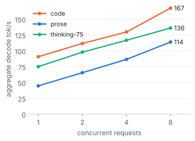
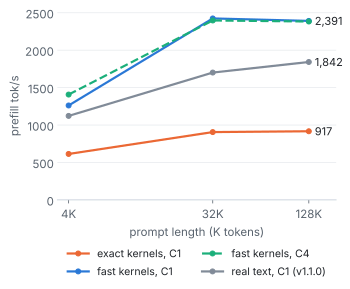
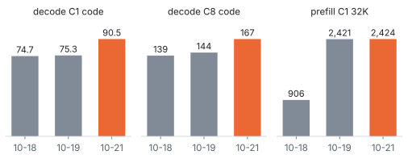

<h1 align="center">DeepSeek-V4.1-Flash-1017 on two DGX Sparks</h1>

<p align="center">A sparkrun recipe for DeepSeek-V4.1-Flash-1017 (EXL3 2.9 bpw, Engram from local NVMe) at TP=2 over CX-7.<br>TensorFold-based engine, exact DSpark drafts with a refit drafter, OpenAI-compatible endpoint.</p>

<table align="center">
  <tr>
    <td align="center"><h2>-6% to -25%</h2><b>agentic wall time, C8</b><br><sub>24 prompts of 8K / 16K / 32K tokens, vs v1.1.0</sub></td>
    <td align="center"><h2>75 → 50 s</h2><b>median TTFT, agentic 16K, C8</b><br><sub>-24% to -33% across the 8K, 16K, 32K buckets</sub></td>
    <td align="center"><h2>95 / 170 tok/s</h2><b>decode C1 / aggregate C8</b><br><sub>code, T=1.0, top_p 1.0; v1.1.0: 95 / 169</sub></td>
    <td align="center"><h2>32 of 32</h2><b>token-identical</b><br><sub>at C1 and C8; full gate passed</sub></td>
  </tr>
</table>

<p align="center"><sub>262K context, 8 sequences in parallel, FP8 KV, DSpark drafts with drafter D1, v1.2.0 against v1.1.0 in alternating boots on my pair, 2026-10-28</sub></p>

<details>
<summary><sub>Measurement details</sub></summary>

| Metric | v1.1.0 | v1.2.0 | Workload | Sampling | Statistic |
|---|--:|--:|---|---|---|
| Agentic C8 wall, 8K prompts | 208.8 / 184.2 s | 178.2 / 173.3 s (-14.7% / -5.9%) | 24 agentic prompts of 7,958 to 8,579 tokens, 8 at a time, up to 1,024 new tokens | 75% greedy, 25% T=1.0 top_p 1.0 | one run per boot, boot pair 1 / pair 2 |
| Agentic C8 wall, 16K prompts | 333.0 / 328.7 s | 249.5 / 248.6 s (-25.1% / -24.4%) | 24 prompts of 15,510 to 17,065 tokens | same | same |
| Agentic C8 wall, 32K prompts | 593.2 / 588.0 s | 519.2 / 517.4 s (-12.5% / -12.0%) | 24 prompts of 28,820 to 33,108 tokens | same | same |
| Median TTFT, 16K prompts | 75.1 / 67.1 s | 50.1 / 48.5 s | same | same | median of 24 requests per boot |
| Decode C1 / C8, code | 95.5 / 169.2 tok/s | 95.5 / 170.4 tok/s | 8 short code prompts, 512 tokens | T=1.0, top_p 1.0 | A/B, pooled per arm, every cell within noise |

The two versions ran in alternating boots (v1.1.0, v1.2.0, v1.2.0, v1.1.0) on 2026-10-28 and 2026-10-29, the same
prompts in the same order on every boot. The replies were text-identical between the versions on all 144 agentic
requests. Image `ghcr.io/ursuciprian/ds41-tensorfold:v1.2.0` (engine commit `21090db`) with drafter D1 and the
settings in [recipes/](recipes/). The decode tile is the median of 2 runs on each of the two boots per version; the
v1.1.0 release figure on three prompts was 92.8 tok/s at C1. No decode cell changed beyond noise.

Method, prompts and the full tables: [BENCHMARKS.md](BENCHMARKS.md#2026-10-28-v120-release-recipe). Chart data:
[docs/data/bench.csv](docs/data/bench.csv).

</details>

This is a work in progress. I am working on speed (prefill at 4K, scheduling under concurrency, the drafter on
code), and the numbers above are what the recipe in this repo does today. Nothing here counts a speedup I have not
measured end to end.

## Quick start

Requirements:

- 2x DGX Spark with the ConnectX-7 ports cabled back to back, both RoCE rails up.
- [sparkrun](https://sparkrun.dev) 0.3.8 or newer, with both nodes reachable over SSH.
- About 315 GiB free on each node's NVMe, and about 285 GiB more on the node that packs the Engram tables
  while it packs (see [Hardware and storage](#hardware-and-storage)).
- The checkpoint, the drafter overlay and the packed Engram shards in place under `/srv/ds41` on both nodes:
  [docs/setup.md](docs/setup.md) walks through the download, the packing, the copy to the worker and the drafter.

```sh
sparkrun registry add https://github.com/ursuciprian/DeepSeek-V4.1-Flash-1017-2x-DGX-Spark
sparkrun run deepseek-v4.1-flash-1017-2x-dgx-spark --hosts <head>,<worker> \
  -e DS41_MASTER=<head CX-7 IPv4> --no-follow
```

Upgrading from v1.1.0: the image changes, and the recipe writes out the new prefix-reuse default. Upgrading from
v1.0.1: build `/srv/ds41/checkpoint-d1` on both nodes first ([docs/setup.md](docs/setup.md#drafter-d1)), or set
`model:` back to `/srv/ds41/checkpoint` in your copy of the recipe.

`DS41_MASTER` is the head's address on the CX-7 link. Without it the ranks meet on the head's default-route
address, which on a Spark is often Wi-Fi. sparkrun pulls the image
`ghcr.io/ursuciprian/ds41-tensorfold:v1.2.0` (about 11 GB to download, 25 GB unpacked) on the first
run.

`sparkrun run` returns before the engine is ready. A boot takes about 5 minutes (295-300 s on four boots on my
pair; the first boot of a new image also compiles kernels and measures a cost table). Wait for health, then
send a request:

```sh
H=http://<head>:8888
until [ "$(curl -s -o /dev/null -w '%{http_code}' $H/health)" = 200 ]; do sleep 10; done
curl -s $H/v1/chat/completions -H 'Content-Type: application/json' -d '{
  "model": "deepseek-v4.1-flash-1017", "max_tokens": 2048,
  "messages": [{"role": "user", "content": "Write a Python function that reverses a string."}]}'
```

Thinking is on by default at effort `high` (75 on the engine's 1-100 scale, the thinking-75 rows in the
benchmarks). Turn it off per request with `"chat_template_kwargs": {"thinking": false}`, or set
`"reasoning_effort"` to `low`, `medium`, `high`, `max` or a number from 1 to 100.
`max_tokens` covers the reasoning and the answer together.

The server binds 0.0.0.0 with no API key. Keep it on a trusted network or put an authenticating proxy in front.
Stop it with `sparkrun stop --all`.

### Shared servers

The recipe is meant for one user or one trusted team. Prefix reuse shares snapshots across requests: a request
whose system prompt and tools match an earlier one resumes from that request's snapshot, and so does a prompt that
continues an earlier conversation. Neither is keyed by client, so time to first token can tell one client whether
another client sent the same long prefix. On a server shared by several tenants, set `TF_DSV41_PREFIX_SHARE` to
`'0'` in the recipe's `env` (and add `TF_DSV41_SESSIONS: '0'` to turn off the session store too). Both cost the agentic
speedup and I have not booted either setting. A per-tenant isolation key is tracked in [#13](../../issues/13).

<details>
<summary>Paths, interfaces and other settings in the recipe</summary>

- Host paths. sparkrun fills `{model}` in the serve command from the recipe's `model:` field and mounts that
  folder at the same path. It does not fill placeholders in `executor_config.volumes`, so the recipe uses fixed
  paths: `/srv/ds41/checkpoint-d1`, `/srv/ds41/engram-shards`, `/srv/ds41/tf-state` and the seccomp profile
  `/srv/ds41/seccomp-io-uring.json`. Put the files there, make `/srv/ds41` a symlink to where they are, or edit
  those lines in your copy of the recipe.
- Drafter. `model:` is the checkpoint folder with drafter D1 laid over it ([docs/setup.md](docs/setup.md#drafter-d1)).
  Set it to `/srv/ds41/checkpoint` to serve the checkpoint's own drafter: the replies are the same, and on my pair
  prose decodes 6% to 12% slower.
- Interfaces. `NCCL_SOCKET_IFNAME=enp1s0f1np1` and `NCCL_IB_HCA=rocep1s0f1,roceP2p1s0f1` are the names a DGX
  Spark uses by default. If `ip -br link` and `ibv_devices` show other names on your nodes, change them, or delete
  the two lines and let sparkrun detect them. The RoCE v2 GID index is read from sysfs on each rank at start,
  because it can change between boots.
- Sampler. Requests that send no sampler get T 1.0, top_p 0.95, top_k 0. Change these server defaults with
  `-o temperature=...`, `-o top_p=...` and `-o top_k=...`. DeepSeek's card sampler (T 1.0, top_p 1.0) works with
  the GPU sampler the recipe turns on (`TF_DSV41_GPU_SAMPLE=1`); the benchmark rows below use it.
- Context 262,144 tokens, 8 sequences in parallel (aggregate decode still rises from C4 to C8 on my pair), FP8 KV
  cache, a shared KV pool of 1,048,576 tokens: 4 sessions at full context, or 8 whose prompt plus `max_tokens`
  stays under about 131,000 tokens each ([#8](../../issues/8)).
- seccomp. The Engram gate runs in a C worker that reads rows with io_uring (`TF_DSV41_ENGRAM_CGATE=1`). Docker's
  default seccomp profile refuses io_uring, so the recipe points the container at
  [recipes/seccomp-io-uring.json](recipes/seccomp-io-uring.json): Docker's default profile plus `io_uring_setup`,
  `io_uring_enter` and `io_uring_register`, nothing else. Copy it to `/srv/ds41/seccomp-io-uring.json` on both
  nodes. Without the `security_opt` line the worker is meant to fall back to a pool of pread threads; I have not
  booted that configuration.
- Depth policy. `TF_DSV41_ROUND_MS` is a table of round times measured on my pair with the v1.0.0 image. A table
  measured again on the v1.1.0 image was no faster, so the recipe keeps it. If your pair differs, the line can be
  removed and the engine prices rounds from the cost table it calibrates at boot. I have not measured that
  combination.
- Metrics. `GET /metrics` on port 8888 returns Prometheus text: requests, errors, prompt, completion and cached
  tokens, decode rounds, drafted and accepted draft tokens, decode and prefill seconds.

</details>

## v1.2.0 against v1.1.0

v1.2.0 changes the engine (commit `21090db`). The drafter, the weights and the v1.1.0 recipe settings stay; the recipe
adds one line, `TF_DSV41_PREFIX_SHARE: '1024'`, which is the new engine default written out. Both changes give the
same tokens.

- Shared-prefix snapshots. When a prompt's system part (the system prompt and tool definitions before the first
  user turn) is 1,024 tokens or more and matches a stored entry or a prompt in flight, the engine also saves a
  snapshot at the end of that part. The next request over the same system prompt and tools resumes there instead
  of prefilling it again. Agent clients send the same long system prompt with every request, so under concurrency
  this cuts prefill work and queueing. `TF_DSV41_PREFIX_SHARE` sets the minimum length; the default is 1024 and
  `0` turns it off (see [Shared servers](#shared-servers)).
- Admission reclaim. Before the engine refuses a request for lack of memory (HTTP 503), both ranks drop the grammar
  compiler caches, collect garbage and return freed heap to the system, then check again. Refusal messages now include
  both ranks' usable memory and the price of the request ([#11](../../issues/11)).

| Agentic, C8 | v1.1.0, boot 1 / 2 | v1.2.0, boot 1 / 2 | Wall change | Median TTFT, v1.1.0 → v1.2.0 |
|---|--:|--:|--:|--:|
| 8K prompts | 208.8 / 184.2 s | 178.2 / 173.3 s | -14.7% / -5.9% | 44.1 → 31.6 s / 36.1 → 25.6 s |
| 16K prompts | 333.0 / 328.7 s | 249.5 / 248.6 s | -25.1% / -24.4% | 75.1 → 50.1 s / 67.1 → 48.5 s |
| 32K prompts | 593.2 / 588.0 s | 519.2 / 517.4 s | -12.5% / -12.0% | 164.4 → 119.8 s / 139.8 → 106.8 s |

<sub>24 agentic prompts per bucket (multi-turn coding-agent and tool sessions), 8 at a time, up to 1,024 new
tokens, 75% greedy and 25% at T=1.0 top_p 1.0. Boots alternated v1.1.0, v1.2.0, v1.2.0, v1.1.0; each v1.2.0 boot is
compared with the v1.1.0 boot next to it. One run per bucket per boot. Replies text-identical on all 144 requests.</sub>

Short-prompt decode, prefill on real text and time to first token on a short prompt did not change beyond noise
when pooled over both boots; on one of the two boots the chat time to first token was 3.5% higher (0.317 against
0.304 to 0.308 s). Tables in [BENCHMARKS.md](BENCHMARKS.md#2026-10-28-v120-release-recipe). The comparison of v1.1.0 with v1.0.1 is
in [BENCHMARKS.md](BENCHMARKS.md#against-v101).

## Performance

<picture><source media="(prefers-color-scheme: dark)" srcset="docs/img/decode-dark.svg"></picture>
<picture><source media="(prefers-color-scheme: dark)" srcset="docs/img/prefill-dark.svg"></picture>

<sub>Left: aggregate decode tok/s by concurrency, v1.1.0 recipe on 2026-10-25, T=1.0 top_p 1.0, 8 short prompts
per workload, 512 tokens (reasoning included for thinking-75), median of 2 runs on each of two boots. C2 was not
measured on this release. Right: prefill tok/s by prompt length, one request (C1) or four at once (C4, aggregate),
fresh nonce per prompt so nothing comes from a prefix cache. The exact and fast kernel lines use one paragraph
repeated (2026-10-18 and 2026-10-21, median of 3); the grey line is real text on v1.1.0 (median of 6 prompts over
two boots).</sub>

Decode goes from 94.9 tok/s at C1 to 169 tok/s at C8 on code. Prose drafts accept fewer tokens per round, so it
stays lower at every concurrency; D1 narrows that gap. On real text, prefill runs 1,122 tok/s at 4K, 1,701 at 32K
and 1,842 at 128K, against about 2,400 on the repeated paragraph. The 4K cell is noisy: per boot, the median of
three prompts was 1,214 on one boot and 1,114 on the other. These charts are v1.1.0 measurements. In the v1.2.0 A/B
no decode cell, no prefill cell and neither short-prompt time to first token was worse beyond noise when pooled over
both boots, so I did not redraw them.

## Quality gate

The full release gate passed on the v1.2.0 image with drafter D1 on 2026-10-29, at DeepSeek's card sampler
(T=1.0, top_p 1.0), with no prefix-reuse line in the environment, so the engine ran its default of 1024.

| Check | Result |
|---|---|
| Reasoning on and off, tool turn, tool-result-only turn, forced tool call | pass (forced call 3 of 3) |
| Hardmode agentic tool-use suite, T=1.0 | 91 (bar 88), as v1.1.0 |
| Identifier fidelity, six depths, prompts of 15,940 to 247,292 tokens | 20 of 20 exact at every depth, and 20 of 20 in two more runs on the same boot |
| Shared prefix, 4 concurrent chats | 16 of 16 exact |
| Long session, long decode to the 32,768-token cap | no loop |
| Corruption | 0 corrupted characters |
| Exactness against the 2026-10-19 recipe, 32 sequences at C1 and at C8 | token-identical, 32 of 32 each |
| Greedy C1 replies against the v1.0.1 image, 27 replies | text-identical, 27 of 27 |
| Agentic replies against v1.1.0, 144 requests over two boot pairs | text-identical, 144 of 144 |
| Fast prefill vs exact kernels, logits over 16,376 teacher-forced positions (2026-10-19) | top-1 agreement 0.9982 (bar 0.995), mean KL 7.8e-4 (bar 1e-3) |

Lowest MemAvailable on that boot, from boot to the end of the gate and the two extra 248K runs: 5.8 GiB on rank 0,
7.3 GiB on rank 1.

At 241K to 247K tokens the fidelity probe has had an intermittent miss on v1.1.0, and it is a memory limit, not a
wrong answer: in 2 of 17 runs at that depth, 3 or 4 items got no answer because the server refused exactly that many
requests (HTTP 503) after heavier probes on the same boot. No item came back wrong. On v1.2.0 the engine reclaims
host caches on both ranks before it refuses. On a diagnostic boot with the floor raised so that a cold 248K prompt
could not fit, the reclaim ran 54 times and freed 0 to 0.24 GiB on rank 0 each time, and 3 of the 54 requests were
then admitted. It makes a refusal less likely; it does not remove the limit. The v1.2.0 gate boot logged no refusal and no reclaim.
I am tracking it in [#11](../../issues/11). Details per lane: [BENCHMARKS.md](BENCHMARKS.md#gate). The gate is in
[gate/](gate/) and talks to the server over the OpenAI API only.

## History

<picture><source media="(prefers-color-scheme: dark)" srcset="docs/img/history-dark.svg"></picture>

<sub>2026-10-18: baseline with exact prefill kernels, decode at T=1.0 top_p 0.95. 2026-10-19: fast prefill kernels
(tuned grouped GEMM, 2048-row chunks) and the GPU sampler, decode at T=1.0 top_p 1.0. 2026-10-21, v1.0.0: ratio
depth policy with a measured round table, cheaper verify rows, decode at T=1.0 top_p 1.0. Median of 3 each, on a
repeated-paragraph prompt for prefill. v1.1.0 is not in this chart: its C1 cells use two prompts instead of three
and its prefill uses real text, so the bars would not compare; v1.2.0 is left out for the same reason.
[BENCHMARKS.md](BENCHMARKS.md#against-v101) compares v1.1.0 with v1.0.1.</sub>

## Hardware and storage

- 2x DGX Spark: GB10, 128 GB unified memory each. The engine allocates about 100.6 GiB per rank.
- ConnectX-7 back to back, both RoCE functions in use (`rocep1s0f1`, `roceP2p1s0f1`).
- Kernel `6.17.0-1032-nvidia` on both nodes. In earlier work on this pair, `7.0.0-1019-nvidia` broke NCCL memory
  registration once about 85 GB per node was GPU-resident.
- Local NVMe on each node, because the engine reads Engram rows from disk with O_DIRECT during decode:

| What | Size | Where |
|---|--:|---|
| EXL3 2.9 bpw checkpoint | 197 GiB | both nodes |
| Drafter D1 overlay and index (the rest of `checkpoint-d1` is hard links) | 0.5 GiB | both nodes |
| Packed Engram shards (2 files per rank) | 94.4 GiB | both nodes, each its own rank's files |
| Engram source shards 47 and 48 | 190 GiB | the node that packs; delete after packing |
| Rank 1's packed shards, staged for the copy | 94.4 GiB | the node that packs; delete after the copy |
| Engine image | 23 GiB | both nodes |

- Free memory is tight on unified memory. Run the nodes headless and keep at least 5 GiB MemAvailable;
  [docs/setup.md](docs/setup.md#memory) has the details.

## Status

- Recipe: the v1.1.0 settings with the v1.2.0 image and `TF_DSV41_PREFIX_SHARE: '1024'` written out, in
  [recipes/](recipes/). The v1.2.0 boots used the same environment as my v1.1.0 boots without that line, so they
  ran its default, which is the same value (1024 when the tokenizer's role tokens are known, as they are for this
  checkpoint). The other engine settings match this file. The file
  differs from the booted one in host paths, container mount points, the request log name, how the rendezvous
  address is passed, an extra `SYS_PTRACE` capability for debugging on my boots and the server default top_p (1.0
  on my boots, 0.95 here).
- Gate: the full release gate passed on the v1.2.0 image with drafter D1 on 2026-10-29, with exactness 32 of 32
  at C1 and at C8 and the lowest MemAvailable at 5.8 GiB.
- Image: `ghcr.io/ursuciprian/ds41-tensorfold:v1.2.0`, digest `DIGEST_PLACEHOLDER`.
- In this release: shared-prefix snapshots and the admission reclaim ([#11](../../issues/11), still open).
- In progress, tracked as issues; each change has to pass the gate before it lands in the recipe:
  - [#13](../../issues/13) a per-tenant isolation key for prefix reuse
  - [#9](../../issues/9) prefill at 4K, [#4](../../issues/4) round overhead outside verify
  - [#11](../../issues/11) admission refusals at 241K to 247K tokens after heavy load on the same boot
  - a drafter refit with more code, GenAI and agentic prompts

## Repository

| Path | What |
|---|---|
| [recipes/](recipes/) | the sparkrun recipe |
| [docs/setup.md](docs/setup.md) | download, Engram packing, copy to the worker, drafter D1, headless setup, memory notes |
| [tools/pack_engram.py](tools/pack_engram.py) | packs the Engram tables into per-rank shards, and checks them |
| [gate/](gate/) | quality gate, speed matrix and exactness checks (OpenAI API only) |
| [BENCHMARKS.md](BENCHMARKS.md) | every number, with method and provenance |
| [scripts/make_charts.py](scripts/make_charts.py) | renders the charts from [docs/data/bench.csv](docs/data/bench.csv) |

## Acknowledgments

- The engine is my fork of [TensorFold](https://github.com/ashhart/TensorFold) with Jay Leaton's
  DeepSeek-V4.1-Flash family from
  [jayleaton/deepseek-v41-tensorfold-spark](https://github.com/jayleaton/deepseek-v41-tensorfold-spark).
  [tools/pack_engram.py](tools/pack_engram.py) is adapted from his Engram packer, and the image ships his prefill
  tile table unchanged.
- [recipes/seccomp-io-uring.json](recipes/seccomp-io-uring.json) is Docker's default seccomp profile from
  [moby/profiles](https://github.com/moby/profiles) with one rule added.
- The charts use the [Inter](https://github.com/rsms/inter) typeface (SIL OFL 1.1).

## License

Apache-2.0 for this repository ([LICENSE](LICENSE)). The Inter font in docs/fonts is SIL OFL 1.1
([docs/fonts/LICENSE.txt](docs/fonts/LICENSE.txt)). The engine image, the model weights and the drafter overlay have
their own licenses; see [NOTICE](NOTICE). The image is built on NVIDIA's NGC PyTorch container: pulling or running
it means accepting the NVIDIA Software License Agreement and the Product-Specific Terms for NVIDIA AI Products for
the NVIDIA parts (links in NOTICE).
